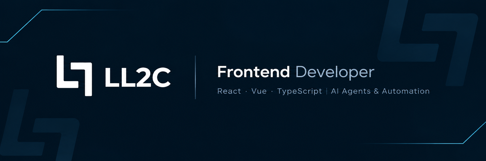

  

<h1 align="center">Lucas Lima</h1>

Front-end developer (Vue, React, TypeScript) building AI agents and automations.

  
  
  
  
  
  

## About

- Front-end developer from Brazil, working with Vue, React and TypeScript.
- Building AI automations and tools for Claude Code under the **LL2C** brand.
- Currently learning: React Native, n8n and AI agents.

 

## Featured Projects

| Project | Description | Stack |
|---|---|---|
| [ll2c-newsletter-ai](https://github.com/LucasLima0202/ll2c-newsletter-ai) | Turns a topic into a researched, AI-written, illustrated newsletter and sends it through Gmail. Free-tier APIs only. | Python |
| [github-readme-skill](https://github.com/LucasLima0202/github-readme-skill) | Claude Code skill that writes README files from what is actually in the project. | Claude Code skill |
| [claude-task-progress-bar](https://github.com/LucasLima0202/claude-task-progress-bar) | Progress bar above the Claude Code prompt that tracks the current task list. | TypeScript |

More projects: [ll2c.netlify.app](https://ll2c.netlify.app/)

## GitHub Stats

  
  

## Contact

- Portfolio: [ll2c.netlify.app](https://ll2c.netlify.app/)
- LinkedIn: [lucas-lima-cunha](https://www.linkedin.com/in/lucas-lima-cunha) <!-- TODO: confirm this URL -->
